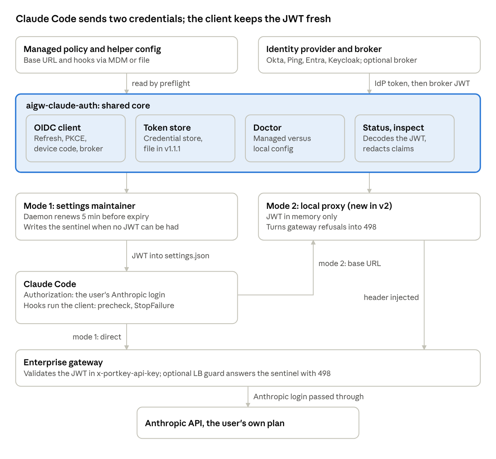
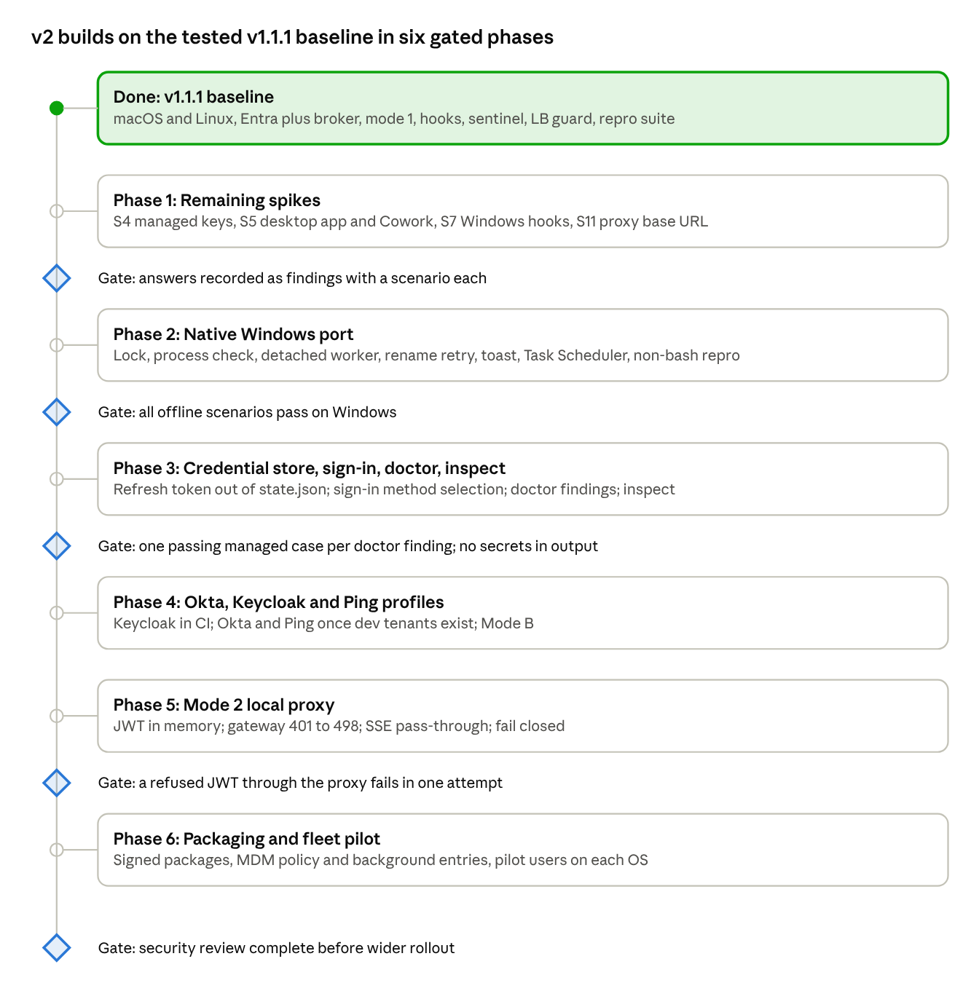

# Design: aigw-claude-auth v2 (gateway JWT for Claude Code)

Oct 25, 2026 · @Matt Harms

## Summary and goals

v2 extends the tested v1.1.1 client in [aigw-claude-code-native-login](https://github.com/thresh97/aigw-claude-code-native-login) from macOS and Linux with one delivery path to all three desktop platforms, four IdPs, and two delivery modes. The core idea is unchanged: Claude Code keeps sending the user's own Anthropic login in `Authorization: Bearer`, the gateway passes it through, and a short-lived IdP-minted JWT in a second header (default `x-portkey-api-key`) tells the gateway who the user is.

**What v1.1.1 already does (tested 2026-10-24/25, Claude Code 2.1.286 and 2.1.308)**

- One stdlib-only Python file, `aigw-claude-auth`, on macOS and Linux.
- Signs in once (PKCE in a browser, device code over ssh), stores the refresh token, and keeps a JWT in `env.ANTHROPIC_CUSTOM_HEADERS` of the user's settings.
- A background daemon renews 5 minutes before expiry; Claude Code picks up the rewritten file about 1 s later.
- Two Claude Code hooks (`UserPromptSubmit` precheck, `StopFailure`) and a sentinel value stop a gateway 401 from triggering Claude Code's multi-minute Anthropic OAuth retry loop.
- Optional token-broker exchange ("Mode A") for IdPs such as Entra ID that cannot emit the gateway's claims.

**v2 goals**

- Native Windows, with the same behavior as macOS and Linux.
- Okta, Ping and Keycloak profiles beside the tested Entra ID path.
- Refresh token in the OS credential store instead of a mode-600 file.
- A second delivery mode: a local proxy that keeps the JWT in memory and can turn gateway 401s into fail-fast errors without a load balancer.
- A `doctor` preflight and an `inspect` view that read managed settings and explain conflicts.
- Fleet deployment through MDM and config management.

**Success criteria**

- A signed-in user never waits out the OAuth loop because of a gateway token problem.
- A conflicting managed setting produces one clear message and a `doctor` report.
- Refresh tokens never sit in plaintext on disk.
- Every v1.1.1 finding still passes on every supported platform (the repo's `repro/run.sh` is the regression suite).

## Scope, non-goals and assumptions

The helper manages one gateway credential in one header for Claude Code users who sign in with their own Anthropic account. It is not an IdP, a gateway, a token broker, or a general secrets manager.

**In scope**

- Claude Code CLI, interactive and `claude -p` (both run the hooks).
- macOS and Linux (v1.1.1 today), native Windows (v2). WSL is Linux and already works.
- Hybrid gateway with or without the optional load-balancer guard; SaaS gateway with hooks only.
- Claude desktop app and Cowork, once the open questions about their config dir, hooks and base URL are answered.

**Non-goals**

- Real Windows services or launch daemons: they run outside the user's session and cannot show notifications or read the user's settings safely.
- Replacing the user's Anthropic login. Billing and Anthropic policy stay with the user's plan.
- Verifying JWT signatures locally by default.
- Cloud sessions in Anthropic-hosted environments, which read no device settings.
- Gateway API keys (static `x-portkey-api-key` values). They need no client; the repo documents them as an alternative.

**Assumptions: what the repo settled and what is still open**

| # | Assumption | Status | Evidence |
| --- | --- | --- | --- |
| A1 | No built-in Claude Code helper can supply the gateway header | Confirmed | `apiKeyHelper` replaces the Anthropic login; a managed `proxyAuthHelper` adds no header to gateway requests (repo finding 11) |
| A2 | Claude Code rereads `ANTHROPIC_CUSTOM_HEADERS` when the settings file changes | Confirmed, about 1 s after an atomic rename | Finding 7 |
| A3 | A managed value wins over the user value for the same `env` key | Confirmed: managed `ANTHROPIC_CUSTOM_HEADERS` replaces the user's whole value | Finding 11 |
| A4 | Unknown top-level keys in managed settings are stripped | Open | Spike S4 |
| A5 | Desktop app and Cowork honor the user settings file, hooks or `ANTHROPIC_BASE_URL` | Open | Repo "Not covered yet"; spike S5 |
| A6 | The gateway validates the JWT in a custom header | Confirmed for the hybrid gateway, Mode A with Entra ID and a broker | Findings 1 and 2 |
| A7 | A gateway 401 is harmless to the client | **Wrong** | A stored login treats it as its own expired Anthropic login: 13 attempts over about 4 minutes (finding 3). See Gateway failure handling |

## Architecture

Every request carries two credentials: the user's own Anthropic login in `Authorization`, which the gateway passes through to Anthropic, and the gateway JWT in `x-portkey-api-key`, which the client keeps fresh. Both modes share one core and differ only in how the JWT reaches the request.

Mode 1 (v1.1.1) writes the JWT into the settings file, which Claude Code rereads within about a second, and Claude Code calls the gateway directly. Mode 2 (new) sits in the request path through `ANTHROPIC_BASE_URL` and injects the header itself. In both, Claude Code's hooks run the same client before each prompt and after a failed turn, so a missing or refused JWT never turns into a gateway 401.

## Gateway failure handling

The hardest part is not keeping the JWT fresh but what happens when it is missing, expired or refused. Claude Code cannot tell a gateway 401 from an Anthropic 401, so with a stored `claude login` a gateway refusal starts Claude Code's own OAuth refresh-and-retry loop: 13 attempts over about 4 minutes, rotating the user's Anthropic login each time, before "Failed to authenticate". Every design choice below exists to avoid sending a 401-provoking request.

**How Claude Code reacts to each status (repo findings 3 to 5)**

| Gateway answers | Stored `claude login` | Login from `CLAUDE_CODE_OAUTH_TOKEN` |
| --- | --- | --- |
| 401 | OAuth loop: 13 attempts, about 4 min | 2 attempts within seconds |
| 498 | 1 attempt, shown at once, login untouched | 1 attempt, shown at once |
| 403, 407 | Not tested | 1 attempt, shown at once |

**Four layers, carried over from v1.1.1 unchanged**

1. **Background renewal.** Renew `refresh_before` (300 s) before expiry. Normally this is all that runs.
2. **Precheck hook (`UserPromptSubmit`).** Before each prompt: renew an expired or nearly expired JWT, then wait `hook_wait` (3 s) so Claude Code reloads it. If no JWT can be had, block the prompt with a reason, so nothing reaches the gateway. When the user is signed out, start a device code sign-in in a detached process and put the URL and code into the block message.
3. **Sentinel.** When no JWT can be had and the current one has under 30 s left, write `x-portkey-api-key: expired`, never an empty or stale value. An optional load-balancer rule answers the sentinel (and a missing header on OAuth requests) with 498.
4. **StopFailure hook.** When a turn failed on a gateway refusal of a JWT that still looked valid (revoked, signing key rotated), force a renewal and notify the user to retry. It acts only on gateway errors (`Portkey Error:`, `API Error: 498`), not Anthropic's.

**Hook constraints**

- Claude Code kills a `UserPromptSubmit` hook after 30 s and sends the prompt anyway, ignoring its block. The hook entry's `"timeout"` is honored; `install` writes 30. Network calls inside hooks use `hook_http_timeout` (5 s).
- Anything that waits for the user runs in a detached process whose stdout is not the hook's, because Claude Code reads the hook's stdout until it closes.
- With `allowManagedHooksOnly`, user hooks do not run, so the hooks must ship in managed settings.

**What v2 adds.** Mode 2 (local proxy) can translate a gateway refusal into 498 itself, which gives fail-fast behavior on the SaaS gateway and on hybrid gateways without a load balancer, where today only the hooks protect the user. On Windows the hooks and sentinel must work identically; hook command quoting for the shell Claude Code uses there is an open item.

## Configuration model and precedence

v2 keeps v1.1.1's per-user config file and strict key set, and adds the ability to read the same keys from managed sources so IT can set them fleet-wide. Managed values win; any disagreement is a `doctor` finding, never silently resolved.

**Sources**

| Source | Location | Helper writes? | Status |
| --- | --- | --- | --- |
| Helper config | `~/.config/aigw-claude-auth/config.json` (override with `--config` or `AIGW_CLAUDE_AUTH_DIR`); Windows `%APPDATA%\aigw-claude-auth\` | No | v1.1.1. Unknown keys are an error |
| Helper state | `state.json` beside the config: refresh token and discovered endpoints, never the JWT, mode 600 | Yes | v1.1.1. v2 moves the refresh token to the OS credential store |
| User settings | First of `--settings`, `AIGW_CLAUDE_SETTINGS`, `$CLAUDE_CONFIG_DIR/settings.json`, `~/.claude/settings.json` | Yes: `ANTHROPIC_BASE_URL`, the header line, two hook entries | v1.1.1 |
| Managed file | `managed-settings.json` (+ `managed-settings.d/`) in `/Library/Application Support/ClaudeCode/`, `/etc/claude-code/`, `C:\Program Files\ClaudeCode\` | No | Read by v2 preflight |
| Managed OS policy | macOS `com.anthropic.claudecode`; Windows `HKLM\SOFTWARE\Policies\ClaudeCode` (`HKCU` lowest priority) | No | Read by v2 preflight |
| Managed helper config | `AIGW_*` keys in managed `env`, or the tool's own policy key or file | No | New in v2, pending spike S4 |
| Server-managed | Fetched by Claude Code at sign-in | Not readable | Reported as "unknown" |

**Config keys.** v1.1.1 keys are kept as they are; v2 adds the last four.

| Key | Default | Meaning |
| --- | --- | --- |
| `issuer` |  | OIDC issuer; endpoints from discovery |
| `token_endpoint`, `device_authorization_endpoint`, `authorization_endpoint` |  | Override discovery |
| `client_id` |  | IdP public client |
| `scope` | `openid offline_access` | Add the gateway's or broker's scope |
| `idp_token` | `access_token` | `access_token` or `id_token` |
| `broker_url` |  | Token-exchange URL (Mode A via broker); empty means the IdP token is the JWT |
| `token_command` |  | A command that prints a JWT, instead of an IdP |
| `header` | `x-portkey-api-key` | Header the gateway reads |
| `sentinel` | `expired` | Written when no usable JWT exists; never empty; must match the LB rule |
| `refresh_before` | `300` | Renew when fewer seconds remain |
| `hook_wait` | `3` | Seconds the precheck waits after a write |
| `block_on_failure` | `true` | Precheck blocks when no usable JWT; never `false` on the SaaS gateway |
| `hook_login` | `device` | Precheck starts a device code sign-in when signed out; `off` where Conditional Access blocks device code |
| `notify` | `auto` | `auto`, `off`, or a command that gets the message as `$1` |
| `redirect_uri`, `redirect_port` | `http://127.0.0.1:{port}/`, `0` | PKCE loopback; `0` picks a free port. Set a fixed port for Okta and Ping |
| `http_timeout`, `hook_http_timeout` | `30`, `5` | Seconds per IdP or broker request outside and inside hooks |
| `mode` (v2) | `file` | `file` (rewrite settings) or `proxy` (local proxy) |
| `proxy_listen` (v2) | `127.0.0.1:0` | Proxy address; must match managed `ANTHROPIC_BASE_URL` |
| `secret_store` (v2) | `auto` | `auto` (OS credential store), `file` (v1.1.1 behavior) |
| `debug_until` (v2) |  | Timestamp after which debug logging turns itself off |

**Rules**

- Never put `ANTHROPIC_CUSTOM_HEADERS` in managed settings in file mode: it replaces the user's whole value, so the JWT is not sent (finding 11).
- Ship `ANTHROPIC_BASE_URL` and the hooks in managed settings for fleets (`install --print` produces the snippet), and keep the JWT in the user's file (`install --no-hooks`).
- The user's `settings.json` must stay replaceable by the user: mode 444 is fine because the client renames over it; an immutable flag (`chflags uchg`) is not, and v1.1.1 blocks the prompt with the error.
- One background process serves one settings file. Run one per `CLAUDE_CONFIG_DIR`, or let the hooks handle the others.

## Mode 1: settings-file maintainer (v1.1.1, extended)

Mode 1 is what v1.1.1 ships: a small background daemon keeps the JWT in the user's settings file, and the two hooks cover every gap. The original design's "scheduled job every few minutes" is replaced by this daemon, because it catches up within a minute of wake and its backoff is easier to reason about; on Windows, a Task Scheduler entry starts the same daemon at log on.

**Daemon loop (`aigw-claude-auth daemon`)**

1. Run `sync`: a local check of the JWT's `exp` in the settings file, no network until a renewal is due.
2. Within `refresh_before` of expiry, take the lock, renew through the IdP (and broker), and write the settings file.
3. Nap at most `--max-sleep` (60 s), so a laptop that wakes catches up within a minute.
4. On failure, back off from 30 s to 5 min. Keep a JWT that still has more than 30 s; after that write the sentinel.
5. After `aigw-claude-auth login`, carry on without a restart.

**`sync` rules**

- Refuse a new JWT with no `exp` or under 60 s left.
- `invalid_grant`, `interaction_required` or `login_required` mean the sign-in is over: drop the refresh token and ask for `login`.
- Persist a rotated refresh token before writing the JWT.

**Write safety (v1.1.1)**

- Temp file, `fsync`, rename, mode 600; keep an existing stricter mode.
- Change only the configured header line inside `ANTHROPIC_CUSTOM_HEADERS`; keep other headers, hooks and keys.
- One lock (`fcntl.flock`) serializes the daemon and the hooks. The interactive part of `login` runs outside it, so a slow sign-in never stalls a hook.
- `install` is idempotent: it finds its own hook entries by the `aigw-claude-auth` name in the command.

**v2 changes**

- Windows: lock with a named mutex or `msvcrt.locking`; retry the rename on `PermissionError` when Claude Code holds the file open; replace `os.kill(pid, 0)` (it terminates the process on Windows) with `OpenProcess`; detach the sign-in worker with `DETACHED_PROCESS`.
- Refresh token from the OS credential store (see Security).
- Run preflight before each write and stop on an error finding.

**Limits**

- The JWT sits in the settings file at mode 600, like Claude Code's own credentials file. It is short-lived; the long-lived secret is the refresh token.
- Only clients that reread the user settings file benefit; desktop app and Cowork are open (spike S5).

## Mode 2: local injecting proxy (new in v2)

A persistent user-space process listens on loopback, adds the gateway header to each request, and forwards to the gateway. Claude Code points at it through `ANTHROPIC_BASE_URL`. The repo lists this as an unbuilt option for keeping the JWT off disk; v2 builds it because it also fixes the case the hooks cannot: fail-fast behavior without a load balancer.

**Why build it**

- The JWT lives in memory only; no token in `settings.json`.
- The proxy sees the gateway's response, so it can turn a gateway refusal (`Portkey Error:` body, or no usable JWT) into **498** before Claude Code sees a 401. That removes the OAuth loop on the SaaS gateway and on hybrid gateways without an LB guard.
- It can renew and retry once on a gateway 401 before answering, so a revoked JWT costs one round trip instead of a failed turn.

**Behavior**

- Start at log on under the single-instance lock (Task Scheduler, launchd agent with `KeepAlive`, systemd user service).
- Pass the caller's `Authorization` (the Anthropic login) and `anthropic-beta` through untouched; the gateway's passthrough config forwards them to Anthropic.
- Strip any client-supplied value for the managed header.
- Distinguish refusals: only gateway errors are translated; Anthropic's relayed 401 (`anthropic error:` with `"provider":"anthropic"`) passes through unchanged so Claude Code can refresh its own login.
- Stream responses without buffering; server-sent events pass through chunk by chunk.
- Fail closed: with no usable JWT, answer 498 with a message that says how to sign in, and start the device code sign-in like the precheck does.
- Expose a control channel for `inspect --live` and health.
- Hooks stay installed: the precheck still gives the best message in the prompt, and the StopFailure hook still covers what the proxy cannot see.

**Local exposure**

On multi-user hosts any local user who can reach the loopback port would get the token injected.

| Option | Isolation | Cost |
| --- | --- | --- |
| Unix socket or named pipe with per-user permissions | Per user | Claude Code must accept a socket base URL, which may not be possible |
| Loopback TCP plus a per-user secret header the client sends | Moderate | Secret must reach Claude Code, for example in the user's `ANTHROPIC_CUSTOM_HEADERS` |
| Loopback TCP, random port, no secret | Weak | Single-user machines only |

Proposed for the prototype: loopback TCP bound to `127.0.0.1` only, documented as single-user. Revisit sockets or secrets if the helper ships to shared hosts.

**Implementation notes**

- Stdlib is enough for a prototype (`http.server` with threads, or `asyncio` with `http.client`); verify chunked and SSE pass-through under load first.
- Keep TLS verification to the gateway; honor the system CA store and proxy settings.
- Log status, latency and token fingerprint only, never bodies.
- Desktop app and Cowork coverage depends on them honoring `ANTHROPIC_BASE_URL` (spike S5).

## Auth flows, token sources and IdP profiles

The client gets an IdP token through one of three OIDC flows, optionally exchanges it at a broker, and writes the result as the gateway JWT. All of it is stdlib (`urllib`, `secrets`, `hashlib`, `http.server`), driven by OIDC discovery.

**Token sources**

| Source | Config | Gateway mode | Status |
| --- | --- | --- | --- |
| IdP token through a broker | `broker_url` set; IdP token sent as `Authorization: Bearer`, response `token` or `access_token` is the JWT | Mode A (gateway's own claims: `portkey_oid`, `portkey_workspace`, nested `defaults`) | Tested with Entra ID |
| IdP token directly | `broker_url` empty | Mode A from an IdP that emits nested claims, or Mode B (plain IdP token, hybrid gateway only) | Mode B untested |
| External command | `token_command` | Any | Supported; `login` does not apply |

On the gateway config claim: the hybrid gateway reads `defaults.config_slug`, the SaaS gateway reads `defaults.config_id` (reported, not tested); the broker sends both.

**Flows**

| Flow | When | Notes |
| --- | --- | --- |
| Refresh-token grant | Every renewal | Persist a rotated refresh token first, under the lock |
| Authorization code + PKCE | `login` on a desktop session | `state` checked; one-shot listener on `127.0.0.1`, port 0 by default; `--no-browser` prints the URL |
| Device authorization grant | `login` over ssh or without a display, `login --device`, and the precheck's background sign-in | Handles `authorization_pending` and `slow_down`; the device code is passed to the worker on stdin and never written to disk |

**Hook-started sign-in (v1.1.0+).** Signed out, the precheck starts one device flow in a detached `hook-login-wait` process, records the user code, URL, expiry and pid in `hook-login.json` (mode 600), and blocks the prompt with "open \<device page> and enter the code ...". A second prompt gets the same code. When the user finishes in any browser, the worker stores the refresh token, writes the JWT and notifies. A decline is logged and notified, and the next prompt gets a new code. Set `hook_login: off` where Conditional Access blocks the device flow.

**Provider profiles**

| Provider | Issuer shape | Configure and test |
| --- | --- | --- |
| Entra ID (tested) | `https://login.microsoftonline.com/{tenant}/v2.0` | Public client; "Allow public client flows" for device code; platform "Mobile and desktop applications" with `http://127.0.0.1` (any port) for PKCE, else `AADSTS500113`; `offline_access`; broker scope such as `api://<broker app>/access_as_user`; cannot emit nested claims, so Mode A needs the broker. Refresh tokens rotate |
| Okta | `https://{org}/oauth2/{authServerId}` | Custom authorization server for custom claims; may emit Mode A claims directly; exact redirect match, so set `redirect_port`; enable the device grant |
| Keycloak | `https://{host}/realms/{realm}` (older: `/auth` prefix) | Protocol mappers can emit nested claims; normal refresh tokens follow SSO idle timeout, `offline_access` gives an offline token; enable the device grant. Easiest to run in Docker for tests |
| Ping | PingOne `https://auth.pingone.com/{envId}/as`; PingFederate `https://{host}:9031` | Endpoints and policies differ between the two; exact redirect match |

For each new provider, confirm with `status` or `inspect` that the token carries the audience, issuer and (Mode A) claims the gateway expects before rollout.

## Sign-in method selection and in-session re-login (new in v2)

v2 picks the sign-in method from an explicit, overridable order, remembers what worked, and can re-sign-in from inside a Claude Code session with either PKCE or device code. It never assumes the device grant exists. v1.1.1 has a narrower version of this: `login` auto-detects from `SSH_CONNECTION`, `SSH_TTY`, `DISPLAY` and `WAYLAND_DISPLAY` (macOS counts as a GUI); the only override is `--pkce` / `--device` per run; and the in-session path (`hook_login`) is device code or nothing.

**Methods**

| Method | Needs | Works for |
| --- | --- | --- |
| `pkce` | A browser that can reach the client's loopback port | Desktop GUI; VS Code remote and dev containers (port forwarding); WSL2 (localhost forwarding) |
| `pkce-print` | The user opens the printed URL themselves; loopback must still be reachable from that browser | GUI with no auto-open; ssh with `ssh -L <redirect_port>:127.0.0.1:<redirect_port>`; containers with the port published |
| `pkce-paste` | The user completes sign-in in any browser, copies the failed `http://127.0.0.1:...?code=...` redirect from the address bar, and pastes it into `login --paste` | Headless hosts without the device grant. Needs a terminal, so it is offered in a block message, not run inside the hook |
| `device` | IdP device grant enabled and not blocked by policy | ssh, containers, CI-like shells, any host without a browser |
| `token_command` | An external tool | CI, workload identity, corporate token tools; no interactive sign-in at all |

**Precedence (first match wins)**

1. CLI flag: `--pkce`, `--pkce-print`, `--paste`, `--device`.
2. Environment: `AIGW_LOGIN_METHOD` (per shell, container or CI job).
3. Config `login_method` (managed beats local): `auto` (default) or a method name.
4. Remembered method: the method of the last successful sign-in, if it is viable in the current environment.
5. Auto-detection (below), filtered by what the IdP supports.

**Auto-detection.** Classify the environment as GUI or headless, then pick `pkce` for GUI and `device` for headless; if that method is unavailable, use the next viable one (`pkce-print`, then `pkce-paste` via terminal).

| Signal | Classification |
| --- | --- |
| `SSH_CONNECTION`, `SSH_TTY` set | Headless, unless `BROWSER` is set (forwarded opener) |
| Container markers: `/.dockerenv`, `/run/.containerenv`, `KUBERNETES_SERVICE_HOST` | Headless, unless `BROWSER` or VS Code remote markers are set |
| VS Code remote (`VSCODE_IPC_HOOK_CLI`, `BROWSER` pointing at its helper) | GUI through forwarding: `pkce` |
| WSL (`WSL_DISTRO_NAME`) | GUI via the Windows browser (`wslview`, `explorer.exe`) if localhost forwarding works, else headless |
| macOS with a GUI login session for this user (`launchctl print gui/$UID` succeeds) | GUI |
| Linux with `DISPLAY` or `WAYLAND_DISPLAY` | GUI |
| Windows interactive desktop session (not a service, not an ssh session) | GUI |
| None of the above | Headless |

**What the IdP supports.** Read `grant_types_supported` and `device_authorization_endpoint` from discovery. Also learn at run time: when `device_start` fails with `unauthorized_client`, `invalid_grant` or a policy error (Entra Conditional Access, `AADSTS` codes), record `device_unavailable` in state with a time-to-live (default 24 h) and stop offering it. Do the same for PKCE when the redirect URI is refused (`AADSTS500113`, `redirect_uri_mismatch`).

**In-session re-login (precheck hook)**

1. Choose the method with the same precedence. Prefer the remembered method; fall back if it is not viable here (for example, last sign-in was `pkce` on the desktop but this session is over ssh).
2. `device`: as in v1.1.1, a detached worker polls, and the block message shows the URL and code.
3. `pkce` and `pkce-print`: a detached worker starts the loopback listener on `redirect_port` and, for `pkce`, opens the browser. The block message carries the sign-in URL so it works even if no browser opened. One pending sign-in at a time, reused by later prompts, expiring after 10 minutes.
4. Neither viable: block with exact next steps: `aigw-claude-auth login --paste` in a terminal, or the `ssh -L` command for the configured port.
5. On success, the worker stores the refresh token, writes the JWT, records the method in `last_login_method`, and notifies.

**Config additions (v2)**

| Key | Default | Meaning |
| --- | --- | --- |
| `login_method` | `auto` | Default method for `login`; overridden by CLI flags and `AIGW_LOGIN_METHOD` |
| `hook_login` | `auto` | v1.1.1 values `device` and `off` stay valid; `auto` means use the same precedence as `login`, preferring the remembered method |
| `redirect_port` | `0` | Use a fixed port where the IdP needs an exact match or for `ssh -L` and container publishing |
| `device_unavailable_ttl` | `86400` | Seconds to remember that the device grant was refused |

**Non-interactive runs.** `claude -p` runs the hooks too. In CI or scripts, set `AIGW_HOOK_LOGIN=off` (or use `token_command`), so a prompt blocks with a clear message instead of starting a sign-in nobody will complete.

**Tests to add.** A unit matrix of environment signals to the chosen method; `FakeIdP` with the device grant disabled, so in-session PKCE and the `--paste` path are exercised; remembered method reused and correctly overridden; a learned `device_unavailable` expiring; manual runs over ssh with `ssh -L`, in a Docker container with a published port, in a VS Code dev container, and on WSL2.

## Preflight and `doctor` (new in v2)

`aigw-claude-auth doctor` reads every config source, predicts what Claude Code will send, and explains conflicts in a report IT can paste into a ticket. The same checks run before each daemon write and in the precheck, where an error becomes the block reason. v1.1.1 already catches some of these at write time (the immutable file); v2 names them before they cost a turn.

**Findings**

| Finding | Severity | Basis |
| --- | --- | --- |
| Managed settings define `ANTHROPIC_CUSTOM_HEADERS` (file mode) | Error | Confirmed: replaces the user's value, JWT not sent (finding 11) |
| `allowManagedHooksOnly` is set and the managed hooks lack the precheck or StopFailure entry | Error | Confirmed: user hooks do not run (finding 11) |
| Hook entry missing, points at a different binary, or has no `timeout` | Error / Warning | Without `timeout` the 30 s default kills a slow precheck and sends the prompt (finding 8) |
| User `settings.json` immutable or not replaceable by the user | Error | Confirmed: renewal fails (finding 11) |
| Managed `ANTHROPIC_BASE_URL` differs from the user's, or (proxy mode) from `proxy_listen` | Error | Requests bypass the gateway or the proxy |
| Settings file the daemon writes differs from the one Claude Code reads (`CLAUDE_CONFIG_DIR`) | Error | The JWT lands in the wrong file |
| `block_on_failure: false` against a SaaS gateway | Error | Sentinel then gets a 401 and the OAuth loop |
| Sentinel empty, or does not match the documented LB rule | Error / Info | An empty header cannot be told from a missing one; LB rule cannot be read locally |
| Managed `apiKeyHelper` or API-key / auth-token env var | Warning | Replaces the Anthropic login the passthrough relies on |
| Mode, issuer, client ID or header differ between managed and local config | Error | Ambiguous intent, wrong audience |
| Current JWT's `iss`, `aud` or Mode A claims differ from configuration | Error | Gateway will refuse it |
| Refresh token stored in a file while `secret_store` is `auto` and a store is available | Warning | Migration incomplete |
| Server-managed settings in use | Info | Not readable by the helper |

**Behavior**

- Error: write nothing; in the precheck, block with the finding; in proxy mode, answer 498 with it.
- Notify on a change of the findings hash only, and recover automatically when it clears.
- Redact token values; show fingerprints.

**Limit.** The helper sees files, not Claude Code's merged config. The repo's `managed` scenario is the way to check the predictions: extend it with one case per finding.

## JWT inspect and debug mode

v1.1.1's `status` already shows the settings file, token source, sign-in state, a JWT fingerprint, expiry and the `iss`, `sub` and `portkey_workspace` claims, never the token. v2 adds `inspect` for the full interpretation and a time-limited debug mode, in both delivery modes.

**What `inspect` adds to `status`**

- Header: `alg`, `kid`, `typ`; `alg: none` is an error.
- Times: `iat`, `nbf`, `exp` in local time and UTC, time left against `refresh_before`, and why the last `sync` did or did not renew.
- Mode A claims: `portkey_oid`, `portkey_workspace`, and `defaults.config_slug` / `config_id`, checked against the gateway type (hybrid reads the slug, SaaS the ID).
- Verdicts against configuration: issuer, audience, expired, not yet valid, clock skew (compare `iat` with the IdP's `Date` header).
- Which source produced it: IdP directly, broker, or `token_command`; and for an IdP token, access or ID token, or opaque (the Entra Graph-audience trap).
- Last gateway outcome seen by the StopFailure hook or the proxy: `Portkey Error:` versus `anthropic error:`.

**Per mode**

| Command | Mode | Behavior |
| --- | --- | --- |
| `inspect` | Both | Decode the current token: from the settings file (mode 1) or the running proxy (mode 2) |
| `inspect --fresh` | Both | Mint a token without writing it, and decode that; for testing a new IdP profile |
| `inspect --live` | Proxy | Ask the proxy over its control channel; the token never leaves the process |
| `--debug` | Both | Log an `inspect` summary at each renewal, not per request |

**Safety rules**

- Never print the token or signature. Keep v1.1.1's fingerprint format (length and a short hash), the one the repro logs already use.
- Redact `sub`, email and groups by default; `--show-claims` reveals them.
- Debug turns itself off at `debug_until` (default 24 h after it was enabled) and warns while on.
- Log files user-only, rotated and capped. (v1.1.1's macOS log is never rotated; v2 fixes that.)
- Output says the signature was not verified; optional `--verify` against `jwks_uri` needs RSA, which is outside the standard library.

## Security and privacy requirements

v1.1.1 already meets most requirements; the gaps are the refresh token at rest and the JWT on disk, which v2 closes with the OS credential store and mode 2. A security review of storage, proxy exposure and redaction gates rollout beyond a pilot.

| Requirement | v1.1.1 | v2 |
| --- | --- | --- |
| Refresh token never in plaintext on disk | Gap: `state.json`, mode 600 | OS credential store (Credential Manager or DPAPI, Keychain, libsecret); file only with `secret_store: file` or no store available |
| JWT off disk | Gap: in `settings.json`, mode 600, short-lived | Mode 2 keeps it in memory |
| No tokens, codes, verifiers or JWTs in logs, notifications or `status` | Met: fingerprints and non-secret claims only | Same, plus claim redaction by default in `inspect` |
| Device code never on disk | Met: passed to the worker on stdin | Same on Windows |
| Atomic, private writes | Met: temp, `fsync`, rename, mode 600 | User-only ACL on Windows |
| PKCE `state` checked; loopback listener on `127.0.0.1`, closed after one request | Met | Same |
| TLS verified to IdP, broker and gateway | Met (stdlib defaults) | Honor the system CA store on Windows and macOS |
| Discovery `issuer` matches configuration | Not checked | Reject a mismatch |
| Proxy loopback-only; client header stripped; no body logs | n/a | Required |
| Debug expires | n/a | Required |
| Signed, packaged binary | n/a: users copy one file | Signed package or binary per OS |

**Threats considered**

| Threat | Mitigation |
| --- | --- |
| Another local user reads the settings file or state | Mode 600 / user ACL; credential store; mode 2 |
| Another local user uses the proxy | Single-user documentation, or per-user socket or secret |
| Overlapping runs burn a rotating refresh token | One lock around refresh-and-persist (v1.1.1) |
| Stolen JWT | Short lifetime; a Mode A JWT cannot be revoked before `exp`. Lifetime guidance is open |
| Stolen refresh token | Credential store; IdP session policy and revocation |
| Gateway 401 rotates the user's Anthropic login repeatedly | Hooks, sentinel, LB guard or proxy translation (Gateway failure handling) |
| Agent reads the token files | Claude Code permission rules that deny reading them (repo idea, not built) |

## Platform specifics

macOS and Linux are done in v1.1.1; Windows is the main porting job. Keep each platform piece behind a small interface so the single-file client stays readable.

| Piece | macOS (v1.1.1) | Linux (v1.1.1) | Windows (v2) |
| --- | --- | --- | --- |
| Background start | launchd agent in `~/Library/LaunchAgents/`, `launchctl bootstrap gui/$(id -u)` | systemd user unit, `Restart=on-failure`, `RestartSec=30` | Task Scheduler "At log on", run as the user, restart on failure, one instance |
| Lock | `fcntl.flock` | `fcntl.flock` | Named mutex or `msvcrt.locking` |
| Process check | `os.kill(pid, 0)` | same | `OpenProcess` via `ctypes`: `os.kill` terminates the process on Windows |
| Detached sign-in worker | `start_new_session` | same | `DETACHED_PROCESS` / `CREATE_NEW_PROCESS_GROUP` |
| Settings write | Atomic rename | Atomic rename | Atomic `os.replace` with retries on `PermissionError` |
| Refresh-token store | File today; Keychain via `security` in v2 | File today; libsecret via `secret-tool` in v2, file fallback | Credential Manager or DPAPI via `ctypes` |
| Notifications | Notification Center (`osascript`) | `notify-send` | Toast through `powershell.exe` and WinRT, `-EncodedCommand`, no console window; own AppUserModelID |
| Hook command | POSIX shell | POSIX shell | Quoting for the shell Claude Code uses on Windows (open) |
| Logs | `~/Library/Logs/aigw-claude-auth.log` (not rotated) | journald | `%LOCALAPPDATA%\aigw-claude-auth\logs`, rotated |
| Repro | bash 4+ | bash | Non-bash runner needed |

**Notes**

- macOS: the launchd agent runs `/usr/bin/python3`, which needs the Xcode Command Line Tools; otherwise change the path. A plist in `/Library/LaunchAgents/` covers all users for MDM.
- Linux: a unit in `/etc/systemd/user/` enabled with `systemctl --global enable` covers all users. Timer- or service-launched notifications may need `DBUS_SESSION_BUS_ADDRESS`. Headless hosts have no notifier or secret service: hooks plus file storage.
- Windows: Windows PowerShell 5.1 is always present; PowerShell 7 is optional and not the target. Use `pythonw.exe` or a windowless binary. AppLocker or Constrained Language Mode can block the WinRT toast; test on a corporate image. Never a Windows service: it cannot show toasts or act in the user's session.
- Interpreter: Windows has no Python and macOS needs the Command Line Tools. Fleet rollout should ship a bundled interpreter or one compiled binary; individual users can keep copying the single file.

## Deployment and MDM

The tested fleet recipe from v1.1.1 is: hooks and `ANTHROPIC_BASE_URL` in Claude Code managed settings, the JWT in each user's own file. MDM (macOS, Windows) and config management (Linux) deliver the managed policy, the client and its background entry, and that avoids the circular dependency server-managed settings would create.

**Gateway side (once)**

1. Create the passthrough config: it forwards the caller's `authorization` and `anthropic-beta` to Anthropic; its `api_key` is a placeholder. Bind it to the credential (JWT `defaults.config_slug` on hybrid, `config_id` on SaaS) or make it the workspace default.
2. Point the gateway's JWT validation (JWKS, issuer, audience) at the IdP or broker.
3. Optional, hybrid only: the LB guard. On an L7 load balancer, answer the sentinel with 498 "expired", forward any other header value, answer a missing header on OAuth requests (`anthropic-beta` contains `oauth-2025-04-20`) with 498 "missing", forward the rest.

**Client side**

| Item | macOS | Windows | Linux |
| --- | --- | --- | --- |
| Managed policy (base URL, hooks; never `ANTHROPIC_CUSTOM_HEADERS`) | Profile for `com.anthropic.claudecode`, or the managed file | `HKLM\SOFTWARE\Policies\ClaudeCode` via GPO or Intune, or the managed file | `/etc/claude-code/managed-settings.json` (no MDM-style channel documented) |
| Snippet source | `aigw-claude-auth install --print --base-url ... --hook-command /usr/local/bin/aigw-claude-auth` | same | same |
| Client | Signed pkg | MSI or MSIX | Package or bundled binary |
| Background entry | Plist in `/Library/LaunchAgents/` | Task for the Users group, or Intune script in user context | Unit in `/etc/systemd/user/`, `--global enable` |
| Helper config | Per-user file, or `AIGW_*` in managed `env` (spike S4) | same | same |
| Per user | `install --no-hooks` writes only the JWT; first `login` is interactive | same | same |

**Why this breaks the circularity.** Endpoint-managed delivery needs no network. The first sign-in talks only to the IdP (and broker), never to Anthropic, so it can complete before any Claude request; and with `hook_login: device` it can be done from inside the first blocked prompt.

**Known gaps**

- First sign-in is interactive per user (made painless by the precheck's device code).
- Unmanaged devices get no client: rely on the gateway rejecting them, or a manual install.
- Cowork with a full VM sandbox sees no device policy; cloud sessions read none.
- SaaS gateway: no LB of yours in front, so hooks only (or mode 2), and `block_on_failure` stays `true`.
- Observability: the client logs locally; a heartbeat to the gateway is an open idea.

**Trial install.** `CLAUDE_CONFIG_DIR=~/.claude-aigw` with its own `/login` keeps an everyday Claude Code untouched, because `install` on the real settings file reroutes every running session within a second.

## Open questions and verification spikes

The repo answered three of the original seven spikes; the remaining ones, plus the repo's own "Not covered yet" list, are below. Each is answered by a run, not by reading docs, and recorded as a finding with its scenario.

| # | Question | Status | How to resolve |
| --- | --- | --- | --- |
| S1 | Built-in helper for a custom header? | Answered: no (`apiKeyHelper` replaces the login, `proxyAuthHelper` doesn't reach the gateway) | Re-check per Claude Code release |
| S2 | Settings reread mid-session? | Answered: yes, about 1 s after rename | `headers` scenario guards it |
| S3 | Managed versus user `env` for the same key? | Answered: managed replaces the user's whole value | `managed` scenario guards it |
| S4 | Are unknown keys in managed settings stripped? Can `AIGW_*` keys ride in managed `env` safely? | Cases written (`unknownkey`, `envkeys`, `dropin`, `dropinonly` in the `managed` scenario, also covering `managed-settings.d/`); expectations are predictions; awaits a run by a person (`bash repro/run.sh managed --yes`) | Extend `managed` scenario |
| S5 | Desktop app and Cowork: do they read user `settings.json` `env`, run hooks, honor `ANTHROPIC_BASE_URL`? Which config dir (a GUI app doesn't inherit `CLAUDE_CONFIG_DIR`)? Same OAuth loop on a 401? How is a block message shown? | Open | Mock gateway plus each app |
| S6 | Do server-managed settings apply to users behind the gateway? | Open | Anthropic account team; pilot tenant |
| S7 | Native Windows: hook shell and quoting, settings file locking by Claude Code, toast delivery from a hook | Open | Windows port of the offline scenarios |
| S8 | SaaS gateway: Mode A only, `config_id`, hooks-only behavior | Open (reported, untested) | Run `gateway` and `live_login` scenarios against SaaS |
| S9 | Mode B (plain IdP token, hybrid only) | Open | `client_live` with an empty `broker_url` |
| S10 | Okta, Keycloak and Ping profiles, including Mode A claims straight from the IdP | Open | `client_live` per IdP; Keycloak in Docker for CI |
| S11 | Mode 2 proxy: can Claude Code use a socket base URL? Does a proxy 498 behave like the LB's? | Open | Prototype plus the `errors` scenario against the proxy |
| S12 | 403 and 407 with a stored login | Open | `stored_login` |
| S13 | macOS live scenarios, `claude -p` while signed out, device code expiry | Open | Run by hand |

**Decisions still needed**

- JWT lifetime: 1 h with renewal at 5 min is the broker default. Shorter narrows the stolen-token and offboarding window (a Mode A JWT cannot be revoked); longer cuts IdP calls. Also measure renewal across sleep and the gateway's clock-skew tolerance on `exp`.
- Packaging: single file for individuals, signed bundle for fleets; or a compiled binary.
- Mode 2 isolation on shared hosts.
- Whether gateway API keys get first-class support (they need no client, but a revoked key still triggers the OAuth loop).

## Implementation plan

v2 starts from the tested v1.1.1 client rather than from scratch: the remaining spikes come first, then the Windows port, then the new capabilities, each behind a gate.

Phases are ordered, not dated; dates need an owner and staffing. The Windows port comes before new features so every later phase is built and tested on all three platforms at once. Phases 3 and 4 can run in parallel once the port lands. Mode 2 comes late because modes 1 plus hooks already protect users on hybrid gateways; move it earlier if a SaaS-gateway rollout is the first target, since there only the hooks stand between a refused JWT and the OAuth loop.

**Roadmap in text** (same content as the diagram, for exports and agents). Entra ID is the IdP for every phase until Okta and Ping dev tenants are available; their profiles slot into phase 4.

0. **Done: v1.1.1 baseline.** macOS and Linux; Entra ID plus broker (Mode A); mode 1 daemon; precheck and StopFailure hooks; sentinel; LB guard; `repro/run.sh` with findings 1 to 11.
1. **Remaining spikes.** S4 (unknown keys and `AIGW_*` in managed `env`), S5 (desktop app and Cowork), S7 (Windows hook shell, file locking, toast from a hook), S11 (proxy base URL, proxy 498 behavior).
   - Gate: each answer recorded as a finding with a repro scenario.
2. **Native Windows port.** Lock, process check without `os.kill`, detached worker, rename retry, toast, Task Scheduler entry, hook quoting, non-bash repro runner; tested against Entra ID.
   - Gate: all offline scenarios pass on Windows.
3. **Credential store, sign-in method selection, `doctor`, `inspect`.** Refresh token out of `state.json`; `login_method` precedence, remembered method, in-session PKCE and `--paste`, learned `device_unavailable`; managed-settings findings; full JWT interpretation.
   - Gate: one passing `managed` case per `doctor` finding; sign-in matrix tests pass with the device grant disabled; no secrets in any output.
4. **More IdP profiles.** Keycloak in CI first (no tenant needed); Okta and Ping once dev tenants exist, including a fixed `redirect_port` and Mode A claims straight from the IdP; Mode B.
   - Gate: `client_live` passes per IdP.
5. **Mode 2 local proxy.** JWT in memory; gateway 401 translated to 498; Anthropic 401 passed through; SSE pass-through; fail closed.
   - Gate: a refused JWT through the proxy fails in one attempt with a stored login.
6. **Packaging and fleet pilot.** Signed packages, managed policy and background entries per OS, pilot users on each platform.
   - Gate: security review complete before wider rollout.

Phases 3 and 4 can run in parallel once phase 2 lands. If the first rollout target is a SaaS gateway, move phase 5 ahead of phase 4.

## Test plan

The repo's `repro/run.sh` is the regression suite: it runs the real Claude Code against a mock gateway and a fake IdP (offline) or the real gateway and IdP (live), and marks each expectation `PASS`, `CHANGED` or `ERROR`. v2 keeps every existing scenario green on every platform and adds scenarios for each new behavior.

**Existing scenarios (keep green)**

| Scenario | Covers | Needs |
| --- | --- | --- |
| `unit` | 30 unit tests: settings edits, refresh, sentinel, device and PKCE, hooks, daemon (`FakeIdP`) | Python |
| `headers` | `install`; both credentials sent; running session picks up a renewed JWT | Claude Code |
| `errors` | Claude Code's handling of 401, 403, 407, 498 | Claude Code |
| `precheck` | Renew before the request, `hook_wait`, blocking, hook-started sign-in, LB-guard path | Claude Code |
| `stopfailure` | Renew and notify after a gateway refusal; Anthropic failures ignored | Claude Code |
| `stored_login` | 498 fails once; a gateway 401 runs the OAuth loop | Stored login |
| `gateway`, `live_login`, `client_live` | Real gateway, IdP, broker and Anthropic end to end | Live accounts |
| `managed` | Managed headers, managed hooks, `allowManagedHooksOnly`, read-only and immutable settings, `proxyAuthHelper` | sudo, run by a person |

**New in v2**

| Area | Tests | Environment |
| --- | --- | --- |
| Windows port | All offline scenarios through a non-bash runner; lock, process check, detached worker, rename retry, toast, hook quoting | Windows 11 plus a locked-down corporate image |
| Credential store | Round trip, migration from `state.json`, missing store fallback, rotation under the lock | Each OS |
| Providers | `client_live` per IdP; Keycloak in Docker in CI with rotation, `invalid_grant`, device and PKCE | Keycloak in CI; Okta, Ping tenants by hand |
| `doctor` | One `managed` case per finding; predictions compared with `/status` and observed headers | Each OS |
| `inspect` | Claim interpretation, redaction, fingerprint format, debug expiry | Unit |
| Mode 2 proxy | SSE and chunked pass-through; gateway 401 to 498 translation; Anthropic 401 passed through; renew-and-retry once; fail closed; concurrent requests; not reachable off loopback; `stored_login` with the proxy shows no OAuth loop | Mock gateway, then live |
| Soak | Days of real use across sleep, network loss, clock change | Developer machines |

**Rules carried over from `AGENTS.md`.** No tokens in logs or results (fingerprints only); new behavior needs a `FakeIdP` test; changing an expectation changes the README findings; the `managed` scenario is run by a person, never an agent.

**Exit criteria for v2**

- All repo scenarios `PASS` on macOS, Linux and Windows.
- `stored_login` through mode 2 with a refused JWT fails in one attempt.
- Every `doctor` finding has a passing `managed` case.
- No secret appears in any log, notification, `status`, `inspect` or `doctor` output at default settings.

## Reconciliation with aigw-claude-code-native-login

Where the tested repo and the earlier chat draft disagreed, the repo wins unless v2 deliberately extends it. This table records each difference so later changes don't reopen settled questions. Repo state: commit `ca5ab19` (2026-10-25), client 1.1.1.

| Topic | Chat draft | Repo (tested) | v2 decision |
| --- | --- | --- | --- |
| What the gateway header carries | Generic custom auth header | Second header (`x-portkey-api-key`); `Authorization` stays the user's Anthropic login, passed through | Repo |
| Why not `apiKeyHelper` | "Bearer-only", assumed | It replaces the Anthropic login; `proxyAuthHelper` doesn't reach the gateway | Repo |
| Gateway 401 risk | Not considered | Triggers the OAuth loop (13 attempts, about 4 min) | Repo; becomes a core requirement |
| Hooks | Not in design | `UserPromptSubmit` precheck and `StopFailure` | Repo |
| Sentinel and LB guard | Not in design | `expired` sentinel, 498 from an L7 LB | Repo; mode 2 adds a no-LB equivalent |
| Background mechanism | Scheduled job every few minutes | Persistent daemon, 60 s naps, backoff 30 s to 5 min | Repo; Windows starts the same daemon from Task Scheduler |
| Refresh trigger | Fraction of lifetime (25%) | Fixed `refresh_before` 300 s | Repo |
| Token sources | IdP only | IdP, IdP plus broker (Mode A), `token_command` | Repo |
| Config | `MYTOOL_*` in managed `env` | Per-user `config.json`, strict keys | Repo, plus optional managed keys after spike S4 |
| Refresh token at rest | OS credential store required | `state.json`, mode 600 | v2 adds the store, file as fallback |
| JWT at rest | In settings, or proxy | In settings, mode 600 | Both: mode 1 (repo) and mode 2 (new) |
| Platforms | Windows first | macOS and Linux; Windows listed as not covered with a port checklist | v2 ports to Windows |
| Conflict detection | `doctor` with predicted findings | Fixes at write time; `managed` scenario proves behavior | v2 adds `doctor`, using repo findings as ground truth |
| Debug view | `inspect` with redaction | `status` with fingerprint and three claims | v2 extends `status` into `inspect` |
| Tests | Keycloak in Docker, unit, manual tenants | `repro/run.sh`: real Claude Code, mock gateway, fake IdP, live scenarios | Repo suite is the base; Keycloak CI added |

**Constraints to keep while changing the code (from `AGENTS.md`)**

- One file, Python 3.8+, standard library only; users copy it as is. If v2 needs a package layout for Windows, keep a single-file build for individuals.
- Keep in step: config keys (`DEFAULTS`, `config.example.json`, README table), commands (argparse, README reference), sentinel and 498 bodies (client, LB rules, mock gateway, `env.example`), hook entries (`hook_entry()`).
- Hooks finish well inside 30 s; anything that waits for the user runs detached with its own stdout.
- Bump `VERSION` on behavior changes; new behavior gets a `FakeIdP` test.

## Sources

- [aigw-claude-code-native-login](https://github.com/thresh97/aigw-claude-code-native-login): README (findings 1 to 11, client reference, Not covered yet), `AGENTS.md`, `client/aigw_claude_auth.py` 1.1.1; commit `ca5ab19`, 2026-10-25.
- [Claude Code settings](https://code.claude.com/docs/en/settings) and [managed settings](https://code.claude.com/docs/en/managed-settings): managed file paths, MDM policy locations, precedence.
- Everything not attributed to the repo or the docs is design proposal, not a test result.
